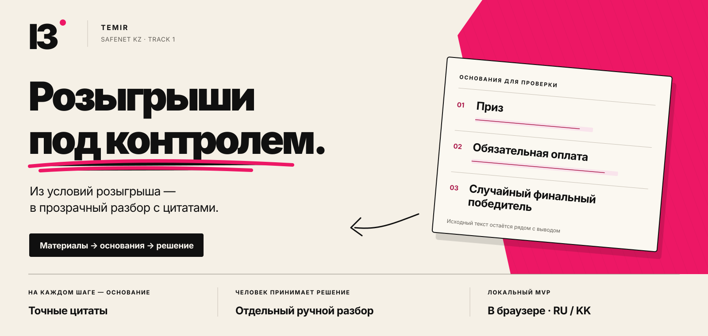
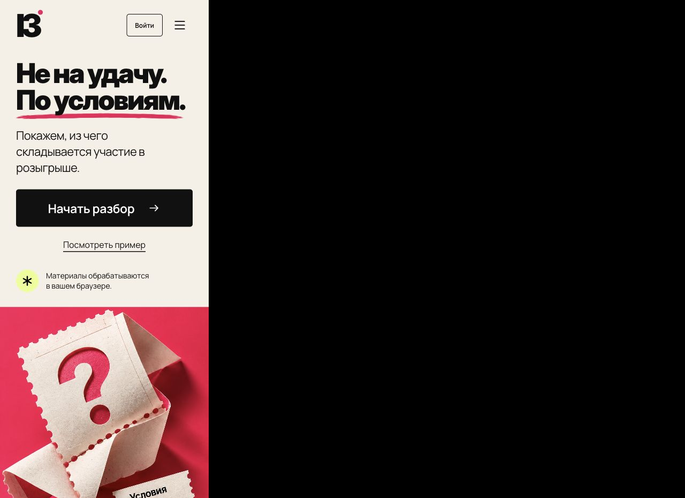
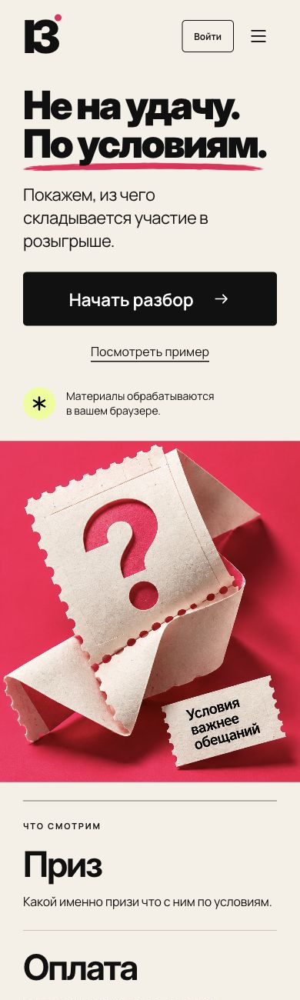

<p align="center">
  <a href="https://iz-safenet-kz.garden-gleam-9738.chatgpt.site/">
    
  </a>
</p>

<p align="center">
  
  
  
</p>

<p align="center">
  <a href="https://iz-safenet-kz.garden-gleam-9738.chatgpt.site/"><strong>Открыть ІЗ ↗</strong></a>
  &nbsp; · &nbsp; <a href="dist/submission/IZ_SafeNet_Deck.pdf">Презентация</a>
  &nbsp; · &nbsp; <a href="FINAL_REVIEW.md">Проверка проекта</a>
  &nbsp; · &nbsp; <a href="ROADMAP.md">План развития</a>
</p>

# ІЗ · Розыгрыши под контролем

**ІЗ помогает собрать условия розыгрыша, найти основания для проверки и сохранить отдельное решение аналитика.** MVP команды **TEMIR** для трека 1 **SafeNet KZ**.

Автоматический приоритет опирается на три признака: **приз → обязательная оплата участия → случайный выбор финального победителя**. Для найденных оснований доступны исходные цитаты и контекст. Приоритет помогает выбрать порядок проверки; он не является вероятностью мошенничества.

## От условий — к проверяемому разбору

1. **Добавьте материалы:** текст публикации, переписку, готовую расшифровку или изображение для OCR.
2. **Проверьте основания:** три признака, точные цитаты, исключённые упоминания и противоречия.
3. **Зафиксируйте решение:** аналитик подтверждает признаки своими цитатами и сохраняет отдельный ручной приоритет и комментарий.
4. **Сохраните результат:** экспортируйте JSON, самостоятельный HTML-отчёт или резервную копию локальных дел.

<table>
  <tr>
    <td width="72%"></td>
    <td width="28%"></td>
  </tr>
  <tr>
    <td><sub>Главный экран на ноутбуке</sub></td>
    <td><sub>Мобильный экран</sub></td>
  </tr>
</table>

## Что уже работает

| Возможность | Что даёт |
| :--- | :--- |
| **Текст и локальный OCR** | Русский, казахский, смешанный текст и ограниченный транслит. Tesseract распознаёт текст изображений в браузере; результат можно исправить. |
| **Цитаты и контекст** | Привязка к исходному тексту, роли оплаты, отрицания, действующие и отменённые условия, предварительный отбор и финальный победитель. |
| **Рабочая очередь** | Локальные дела, фильтры, пакетный JSON-импорт с прогрессом и отменой. |
| **Ручная проверка** | Структурированные подтверждения и история решений. Изменение материалов делает прежний разбор устаревшим. |
| **Связи между материалами** | Граф совпадений полных ссылок и явных контактов с источником каждого ребра. Совпадение не повышает приоритет другого дела. |
| **Сохранение и восстановление** | Черновики, JSON/HTML-экспорт, резервные копии и обработка конфликта записи между вкладками. |

## Локальный запуск

Сайт уже собран в `dist/`: установка пакетов и сборка не нужны. Достаточно Python 3.

```sh
git clone https://github.com/rh-zhako/iz-safenet-kz.git
cd iz-safenet-kz
python3 -m http.server 4173 --directory dist
```

Откройте [localhost:4173](http://localhost:4173). В исходниках — HTML, CSS и JavaScript с нативными ESM-модулями.

**Проверки — по желанию, с Node.js 20+:**

```sh
node scripts/verify.mjs
# Только воспроизведение сохранённого теста v2.0:
node scripts/reproduce-fresh-v8.mjs
```

## Что подтверждено измерением

**Первый тест зафиксированной v2.0 на новом AI-синтетическом наборе v8:**

| Показатель | Результат |
| :--- | :--- |
| Совпадение трёх уровней приоритета | **100/160 · 62,5%** |
| Высокий приоритет | TP **34** · FP **12** · FN **30** · TN **84** |
| Precision / recall / FPR высокого приоритета | **73,9% / 53,1% / 12,5%** |
| Ошибки привязки цитат | **0** |

Движок был зафиксирован до создания v8; первый отчёт и все 60 несовпадений сохранены. Это **AI-синтетика**: реальных публикаций, человеческой разметки и измеренной экономии времени в этой оценке нет. Патч **2.0.1** исправляет границу слова в правиле судейского выбора и проверен на уже раскрытых данных; новой слепой точности после изменений пока нет.

Отдельно проверены **528 программных проверок** и воспроизведены **340 сохранённых прогнозов**. Эти проверки не являются точностью детектора. Протокол — в [методологии](METHODOLOGY.md), результаты обзора — в [FINAL_REVIEW.md](FINAL_REVIEW.md), исходный первый отчёт — в [evaluation/fresh-ai-v8-report.json](evaluation/fresh-ai-v8-report.json).

## Данные и границы MVP

Прикладной текст, OCR и ручные решения обрабатываются локально в браузере. Дела хранятся на устройстве, зависят от квоты браузера и не синхронизируются между устройствами. Для переноса используйте резервную копию.

Google-вход используется только для отображения email в текущей вкладке. Серверной сессии, командных ролей и синхронизации дел нет. Для нового домена нужно отдельно добавить origin в разрешённые адреса Google OAuth.

Детектор использует прозрачные словарные и контекстные правила; незнакомые формулировки могут приводить к пропускам и ложным высоким приоритетам. Загрузки публикаций по ссылке, захвата эфира и автоматической расшифровки аудио нет. Система не устанавливает мошенничество, законность, безопасность участия, подлинность материалов или общего владельца аккаунтов.

## Материалы проекта

| Материал | Назначение |
| :--- | :--- |
| [Презентация · PDF](dist/submission/IZ_SafeNet_Deck.pdf) / [PPTX](dist/submission/IZ_SafeNet_Deck.pptx) | Короткое представление проекта и редактируемые слайды |
| [PITCH.md](PITCH.md) | Сценарий демонстрации на пять минут |
| [ENGINE_V201.md](ENGINE_V201.md) / [v2.0](ENGINE_V20.md) | Текущий патч, история и ограничения движка |
| [METHODOLOGY.md](METHODOLOGY.md) | Как устроены проверка качества и воспроизведение |
| [FINAL_REVIEW.md](FINAL_REVIEW.md) | Итоговая техническая проверка и ограничения |
| [ROADMAP.md](ROADMAP.md) | Следующие шаги к проверке со специалистами |

---

**TEMIR · SafeNet KZ** &nbsp; [Живое демо ↗](https://iz-safenet-kz.garden-gleam-9738.chatgpt.site/) · [Репозиторий](https://github.com/rh-zhako/iz-safenet-kz)
